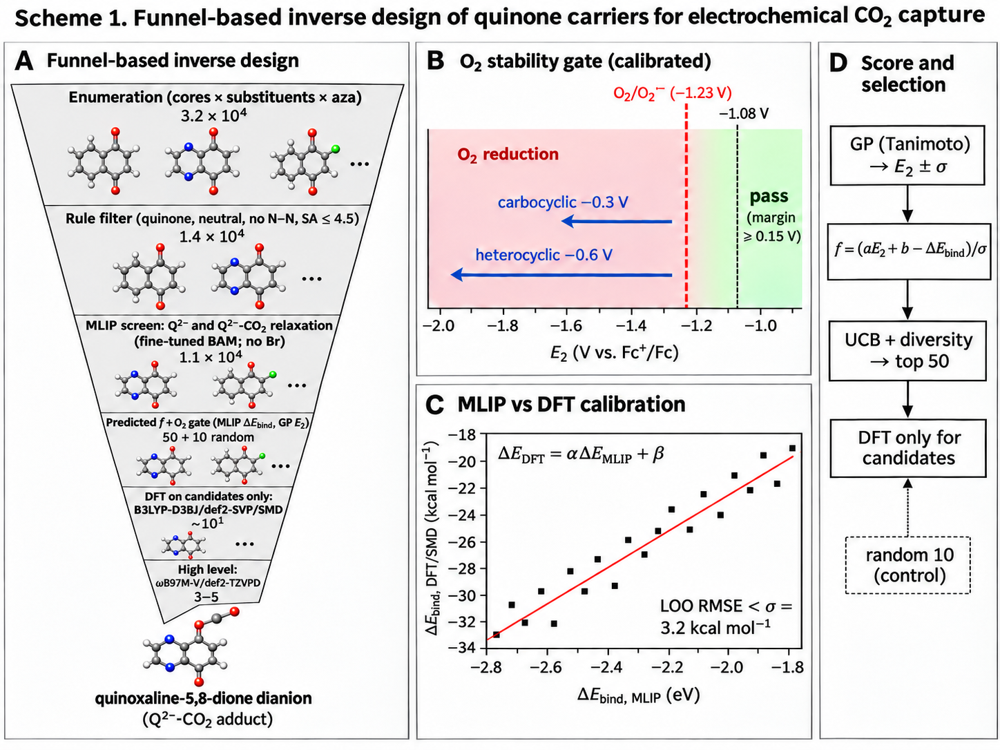
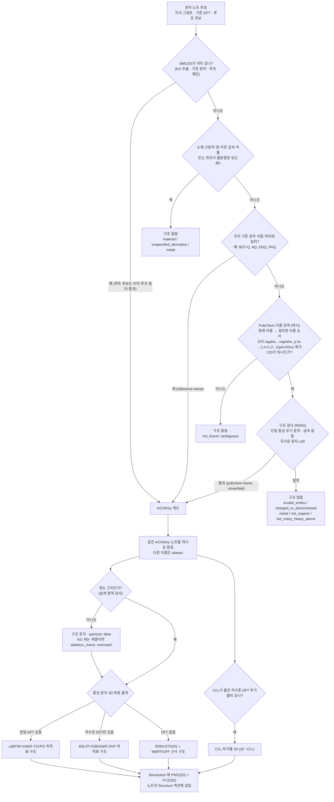

# Quinone vault

전체 탐색: [[Index]]

## Family hubs

- [[Anthraquinone (family)]]
- [[Benzoquinone (family)]]
- [[HeterocyclicQuinone]]
- [[Naphthoquinone]]
- [[NotReported]]
- [[OtherQuinoid]]
- [[Phenanthrenequinone]]
- [[benzodithiophene-dione]]
- [[diaminonaphthoquinone]]
- [[original_1_rings]]
- [[original_2_rings]]
- [[original_3_rings]]
- [[phenanthroline-dione]]
- [[quinoxaline-dione]]

퀴논 CO₂ 포집 논문의 지식 그래프, 우리 DFT 결과, 역설계 루프 후보를 Obsidian 노트로 옮긴 vault입니다.

- 3D 구조를 보려면 커뮤니티 플러그인 **ChemRender3D**가 필요합니다. 2D 그림(PNG)은 플러그인 없이도 보입니다.
- `Index.md`의 표를 보려면 **Dataview** 플러그인이 필요합니다.
- 다시 만들려면 저장소 최상위 폴더에서 `make obsidian`을 실행합니다. 생성된 노트는 새로 덮어쓰고, `.obsidian/`과 직접 쓴 노트는 그대로 둡니다.

## 다음 단계: 깔때기 탐색 (진행 중)

- (A) 깔때기 단계와 남는 분자 수, (B) 보정한 O₂ 안정성 기준, (C) MLIP 결합 에너지를 DFT(SMD) 값으로 보정, (D) 점수 계산과 후보 선택.
- 개념도입니다. 패널 C의 점은 예시이며 실제 보정 데이터가 아닙니다.
- 흐름: 열거 → 규칙 필터 → **직접 학습한 MLIP**(BAM 파인튜닝, ωB97M-V 라벨)로 Q²⁻와 Q²⁻·CO₂를 최적화해 CO₂ 결합 에너지 계산 → MLIP가 못 하는 E₂는 GP로 예측 → 예측 f와 O₂ 기준으로 상위 50개와 무작위 대조 10개 선택 → **DFT는 이 후보에만** 사용.
- MLIP는 전하를 입력받지 않고 이중음이온으로만 학습했으므로 E₂(라디칼 음이온)에는 쓰지 않습니다. Br이 든 분자는 학습 범위 밖이라 제외합니다.

## 분자 구조를 어떻게 정했나

논문에는 분자 이름만 있고 구조(SMILES)는 없는 경우가 많습니다. 아래 순서대로 구조를 찾고, 처음 성공한 단계에서 멈춥니다. 이름으로 찾은 구조에는 노트에 `smiles_source`가 붙습니다. 원래 SMILES가 있던 노트에는 이 필드가 없을 수 있습니다.

- 소재인지 먼저 거릅니다. 그래서 기준 분자 이름과 비슷해도 고분자나 복합체는 구조를 넣지 않습니다.
- `make obsidian`은 저장된 PubChem 조회 결과(캐시)만 씁니다. 새 이름을 조회할 때만 인터넷을 씁니다.
- 원래 SMILES가 있던 분자는 이름 검색용 안전 검사를 다시 하지 않습니다. 루프 후보는 이미 루프 필터를 통과한 분자입니다. 퀴논 고리 검사는 구조를 제외하지 않고 `quinone: false`로 표시합니다. KG의 계열 값은 보존하며, 그 값이 퀴논 계열과 충돌하면 `skeleton_check: "mismatch"`도 표시합니다.

### `smiles_source` 값의 뜻

| 값 | 의미 | 믿을 수 있는 정도 |
|---|---|---|
| 없음 | 논문 추출 기록, 우리 기준 분자, LLM/무작위 제안에 원래 있던 SMILES | 높음 |
| `reference-name` | 우리 기준 분자의 이름이나 약어와 일치 | 높음 |
| `pubchem-name (unverified)` | PubChem 이름 검색으로 찾음 | 중간. 사람 확인 전 |

### 구조 판정 필드

| 필드 | 의미 |
|---|---|
| `quinone: false` | 구조는 표시하되 퀴논 고리가 없어 설계 영역 밖인 분자 |
| `skeleton_check: "mismatch"` | 비퀴논 구조와 KG의 퀴논 계열 기록이 충돌함. KG 계열은 그대로 유지 |

### 구조를 넣지 않은 경우 (사유 코드)

- **material:** 고분자, 탄소나노튜브 복합체, 염처럼 구조 하나로 정할 수 없는 소재입니다.
- **metal:** 금속 착물입니다.
- **unspecified_derivative:** "ester derivative"처럼 치환 위치가 논문에 없습니다.
- **ambiguous:** 같은 이름의 PubChem 후보가 여럿입니다.
- **not_found:** 이름과 정리한 이름 변형으로 모두 찾지 못했습니다. 논문 전용 약어(예: `1,5-BTMAPAQ`)가 대부분입니다.
- **too_many_heavy_atoms:** 무거운 원자가 40개를 넘습니다.
- **charged_or_disconnected / not_organic / invalid_smiles:** 중성 단일 유기 분자가 아니거나 RDKit이 SMILES를 해석하지 못합니다.
- 이전 캐시의 **not_quinone**은 온라인 재조회가 필요한 오래된 결과입니다. 퀴논이 아닌 것 자체는 구조 제외 사유가 아닙니다.
- 남은 이름과 사유는 저장소의 `.omc/research/unresolved_names.md`에 있습니다. SMILES를 알려주면 넣을 수 있습니다.

### 3D 좌표 출처

- 노트의 `Geometry:` 줄에 출처가 적혀 있습니다.
- DFT 구조는 우리가 직접 계산해 최적화한 것입니다.
- RDKit/MMFF 또는 UFF 구조는 모양만 맞춘 근사 구조이므로 결합 길이와 각도를 정량적으로 해석하지 마세요. 두 힘장 모두 지원하지 않으면 ETKDG 좌표를 그대로 표시합니다.
- CO₂ 부가물은 저수준 DFT에서 CO₂가 붙은 결과(O–C ≤ 2 Å)가 있을 때만 들어갑니다.

## 저작권

지식 그래프 근거 인용은 200자 이내로만 넣었습니다. 논문 원문과 초록은 넣지 않았습니다. 값과 가설은 보고된 근거이고 실험으로 검증한 결과가 아닙니다.
